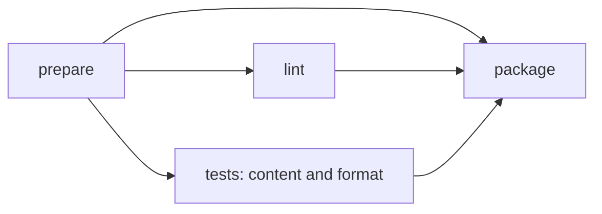

# Run tasks in parallel

Stoke automatically schedules independent tasks as soon as their prerequisites
succeed:

```sh
stoke run test
```

The current scheduler admits at most four active jobs across the entire selected
workflow. This internal bound counts literal tasks, native Coopr builds,
publication requests and every matrix variant. A matrix's `strategy.max-parallel`
adds its own per-task limit. The workflow-wide bound has no CLI, environment or
YAML setting.

This schedules work inside the existing machine or CI runner. It does not
reserve CPU or memory, provision machines or change the task's target
architecture.

## Express the dependencies

The checked-in `examples/parallel-workflow/stoke.yaml` has this graph:



`prepare` copies a text input. `lint` and the two `tests` variants can then run
together. `package` starts only after all three prerequisite logical tasks pass,
including every test variant:

```yaml
version: 1
tasks:
  prepare:
    image: docker.io/library/busybox:1.37
    steps:
      - copy:
          sources: [message.txt]
          destination: /work/message.txt
  lint:
    from: prepare
    cache: false
    steps:
      - run: [sh, -eu, -c, 'test -s /work/message.txt']
  tests:
    from: prepare
    cache: false
    strategy:
      max-parallel: 2
      matrix:
        check: [content, format]
    steps:
      - run: [sh, -eu, -c, 'test -s /work/message.txt; printf "%s\n" "$STOKE_MATRIX_CHECK"']
  package:
    from: prepare
    needs: [lint, tests]
    steps:
      - run: [sh, -eu, -c, 'mkdir -p /dist; cp /work/message.txt /dist/message.txt']
```

The complete checked-in example performs separate content and format checks.
Run it from the repository root:

```sh
stoke check -f examples/parallel-workflow/stoke.yaml
stoke plan -f examples/parallel-workflow/stoke.yaml package
stoke run -f examples/parallel-workflow/stoke.yaml package
```

The example requires the usual [rootless setup](../getting-started.md), an
API-capable Coopr, access to its BusyBox registry image and an appropriate image
policy. Its short commands illustrate the graph; their log timing alone does
not prove overlap.

`needs` adds an ordering gate without copying files. `from`, `copy.from`, native
argument `{from: TASK}` bindings and `publish.from` also add prerequisite edges.
A task waits for every prerequisite logical task, not just one successful
variant. Data-source edges still require an unambiguous singleton producer.
See [workflow graph rules](../reference/workflow.md#graph-rules).

A dependent becomes eligible as soon as its own prerequisites pass. For example,
a task depending only on `lint` can start while an unrelated test branch is still
running, if a job slot is free. Stoke does not wait for a whole graph level to
finish. Tasks outside the selected dependency closure do not run.

When more groups are ready than there are free slots, admission rotates between
groups. An early matrix cannot take every newly available slot while another
independent group waits. Dependencies and matrix limits still determine which
groups are eligible; the final report retains plan order.

## Combine workflow and matrix limits

`strategy.max-parallel` limits variants of one logical task, within the
scheduler's internal four-job workflow bound. Both limits need a free slot
before a variant starts:

| Matrix policy | Maximum active work |
| --- | --- |
| One matrix with `max-parallel: 2` | At most two variants from that matrix; other ready tasks can use remaining workflow slots. |
| One matrix with `max-parallel: 1` | One variant from that matrix; independent ready tasks may still overlap. |
| Two matrices each with `max-parallel: 4` | At most four jobs overall across both matrices and any other ready work. |

A cache hit still occupies an admitted job while Coopr resolves, restores and
exports its result. All jobs in one run share the workflow-scoped Coopr service
and native store roots, with separate output paths. Coopr owns cache identity,
locking and reuse; concurrency does not introduce another cache service or
workflow-result cache. See [caching](caching.md).

Matrix policy remains part of the task definition and retains its normal
import/override behavior. A caller using `uses` can replace the selected task's
entire strategy; the internal workflow bound applies to all resulting jobs.

## Failure and cancellation

A non-matrix job failure stops new workflow admissions, cancels active work and
waits for cleanup. A matrix uses its declared `strategy.fail-fast` policy:

- With `true` (the default), the first variant failure stops workflow admissions
  and cancels active work, including independent branches and sibling variants.
- With `false`, that matrix finishes its active and queued siblings before its
  failed logical group stops the workflow. Unrelated ready work can progress in
  the meantime; the matrix's dependents remain blocked. Another failed logical
  group or external cancellation can still interrupt those siblings.

An external cancellation, including a termination signal, stops admission and
cancels all active jobs regardless of matrix policy. Stoke waits for backend
cleanup acknowledgement before releasing component files and the workflow's
service. Uncertain cleanup remains a failure; it is not reported as a completed
ordinary cancellation. There is no workflow-wide keep-going option.

An independent publication request may complete before a different branch
fails. Cancellation does not roll back a transfer or other effect that already
occurred. Add every required test or approval gate through dependency edges,
for example `needs: [lint, tests]` on a publication task. Running without targets
selects all root tasks, including publication tasks.

## Read plans and reports

`plan` prints a stable topological order for inspection. The final `run.json` and
stdout report keep jobs in that plan order, independently of their completion
order. The order is not a promise of serial execution. Concurrent job logs can
interleave.

Every selected job appears in the report. A job that never starts is `skipped`
with a reason; a canceled active job is `canceled` when cleanup is acknowledged,
and execution or cleanup failures remain `failed`. Successful independent work
can retain its outputs even when the workflow fails. Keep the report's overall
status and dependency gates when deciding whether to publish or consume a run.

Use the recorded paths to collect outputs rather than inferring completion
order or generated matrix names. See the [CLI report reference](../reference/cli.md#execute).

Report updates replace complete files atomically. A report-persistence error
fails the run and appears in the returned report. The saved file can then be
absent or retain an earlier complete report; check the command's exit status
and returned error before using its outputs.
